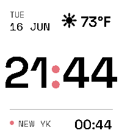

# Homezone

A console/terminal-styled Pebble watchface for the **Pebble Time 2 (emery)**. It
shows the time and date, current weather, and a configurable bottom row that can
display a second timezone, your step count, battery, heart rate or active
calories.

<p align="center">
  
</p>

> The screenshot predates the complication picker, so its bottom row shows the
> second timezone — the default.

## Layout

```
  MON              ☀ 21°C     ← weekday · weather icon + temperature
  18 AUG                      ← date

      20:34                   ← local time (accent-coloured colon)

  ──────────────────────
  ● DUBLIN          19:34     ← bottom-row complication: label + value
```

- **Local time** — hours and minutes in Space Grotesk, centred and measured at
  runtime so the accent-coloured colon always sits mid-line.
- **Weather** — temperature and a hand-drawn weather glyph, top right.
- **Bottom row** — a single configurable complication (see below).

## Features

### Weather

Fetched from [Open-Meteo](https://open-meteo.com) (no API key) using the phone's
geolocation, falling back to a default location when that is unavailable. The
temperature unit is configurable (°C / °F) and it refreshes every 30 minutes.

### Second timezone

Pick from **36 cities**, one per real UTC offset from UTC−11 to UTC+13, including
the sub-hour zones (India +5:30, Nepal +5:45, Iran +3:30, Newfoundland −3:30,
Adelaide +9:30). Each dropdown entry shows its current offset, e.g.
`Dublin (UTC+1)`. Offsets are DST-aware.

### Bottom-row complication

The bottom row shows one of:

| Complication      | Value                        | Notes                                   |
|-------------------|------------------------------|-----------------------------------------|
| **Second timezone** | Local time in the chosen city | The default                             |
| **Steps**         | Today's step total           | Compacted past 9,999 (e.g. `12.4K`)     |
| **Battery**       | Charge percentage            | Reported in 10% steps                   |
| **Heart rate**    | Most recent BPM sample       | —                                       |
| **Active calories** | Today's active kcal        | —                                       |

Steps, heart rate and calories come from Pebble Health and read as `--` while
health tracking is switched off. The watch only subscribes to the battery and
health services while the relevant complication is on screen.

### Custom label

The bottom row's left-hand label can be overridden with your own text (up to 10
characters, shown in capitals). Leave it blank to use the city name — or the
built-in `STEPS` / `BATTERY` / `HEART` / `CALS` — automatically.

### Theme

A light/dark toggle swaps the background and text colours; the accent colour
stays constant.

## Configuration

Settings live on a [Pebble Clay](https://github.com/pebble/clay) config page.

On a **real phone** the Pebble app opens the config page directly — nothing extra
is needed.

In the **emulator**, Chrome blocks the config page's public-page → `localhost`
save redirect under Private Network Access rules. `clay-proxy.html` works around
this by serving the page from `localhost` so both the origin and the return
target are local. Serve the project root, then open the config page:

```sh
# terminal 1 — leave running
python3 -m http.server 8888 --directory .

# terminal 2
pebble emu-app-config --emulator emery
```

The `IS_EMULATOR` flag near the top of `src/pkjs/index.js` selects between these
two paths; `build.sh --prod` sets it to `false` for release builds automatically.

## Building & running

```sh
./build.sh              # build for the emulator
./build.sh --install    # build and install on the running emery emulator
./build.sh --prod       # release build → ../console-watchface-release.pbw
```

`--prod` temporarily sets `IS_EMULATOR = false`, builds, copies the bundle to the
repo root, and restores the flag. Upload that `.pbw` to
<https://dev-portal.rebble.io>.

Manual equivalents:

```sh
pebble build
pebble install --emulator emery
```

> **Note:** after changing `messageKeys` in `package.json`, run `pebble clean`
> before building — the generated `MESSAGE_KEY_*` header is not regenerated
> otherwise and the C will fail to compile.

If the emulator becomes unresponsive (`App install failed`, or a connection
`TimeoutError`), reset it:

```sh
pebble kill && pebble wipe && pebble install --emulator emery
```

## Testing

The phone-side JavaScript is unit-tested with Node's built-in test runner:

```sh
npm test
```

The tests cover timezone offsets and label handling, and the complication list.
Several of them read the C source and `package.json` back and assert that the
JS, the `ComplicationType` enum, the fallback labels and the font subsets all
still agree — the watch decodes these as integers and character-subsetted fonts,
so silent drift would otherwise ship a broken face.

## Architecture

The watchface is split across the standard Pebble C / PebbleKit JS boundary.

| File | Role |
|------|------|
| `src/c/console-watchface.c` | Rendering, layout, persisted settings, Health/battery subscriptions |
| `src/pkjs/index.js`         | Phone side: weather fetch, settings, AppMessage to the watch |
| `src/pkjs/timezones.js`     | The 36-zone table, offset resolution, label normalisation |
| `src/pkjs/complications.js` | The complication list; the source of truth mirrored by the C enum |
| `src/pkjs/config.js`        | The Clay config page definition |
| `src/pkjs/clay-custom.js`   | Clay custom function that shows/hides the city picker |
| `clay-proxy.html`           | Local config-page host for the emulator (see above) |

### Timezones without a database

Pebble has no timezone database, and the emulator's JavaScript engine has no ICU
data — constructing an `Intl.DateTimeFormat` (or calling `Date` locale methods)
**aborts the pkjs process**, uncatchably. `timezones.js` therefore resolves
offsets from a static table with hand-written EU / US / AU / NZ DST rules rather
than `Intl`. The unit tests verify that table against Node's `Intl` (which does
have ICU) across several years, so the data stays honest even though the runtime
never touches it.

The watch stores a fixed UTC offset, so it cannot notice a DST changeover on its
own; the phone re-sends the offset on every weather refresh, so the second
timezone self-corrects within 30 minutes of a changeover.

## Target platform

Built for **emery** (Pebble Time 2, 200 × 228) only. The `"health"` capability
is required for the step, heart-rate and calorie complications.

Full SDK docs: <https://developer.repebble.com>
