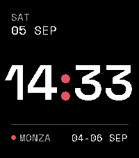
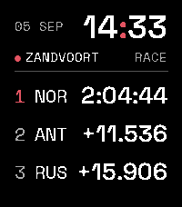

# Pit Wall

A console/terminal-styled Formula 1 watchface for the **Pebble Time 2 (emery)**,
in the same idiom as its sibling [Homezone](../console-watchface).

It has two faces. On the day of an F1 session it is a timing board showing that
session's top three. Every other day it is a clock, with a single row naming the
next race and the days it runs.

<p align="center">
  
  &nbsp;&nbsp;
  
</p>

## Layouts

### Countdown — every other day

```
  SAT
  05 SEP
        14:33                  ← the time, large, accent-coloured colon
  ──────────────────────
  ● MONZA        04-06 SEP     ← the next race and the days it runs
```

The next race's window runs from its first practice session to the race itself,
in your local time. A weekend that straddles a month reads `31OCT-2NOV`. Both
halves of the row go blank when the season is over.

### Board — on the day of a session

```
  05 SEP            14:33      ← date · clock, still readable but demoted
  ● ZANDVOORT        RACE      ← circuit · session
  ──────────────────────
  1  NOR          2:04:44      ← leader: absolute time
  2  ANT          +11.536      ← gap to the leader
  3  RUS          +15.906
```

- **Podium rows** — position, three-letter driver code, and a time. The leader
  always shows an absolute time (a lap in qualifying or practice, the total in a
  race); the rows below show their deficit, or their own time if you prefer.
- **Position** — as reported, not renumbered. If a driver is excluded, the third
  row genuinely reads `4`.

### How the face chooses

The phone sends the local calendar date of the session on the board; the watch
draws the board only while that matches its own date, and re-checks every minute.
So the two layouts change over at local midnight by themselves, rather than
whenever a refresh happens to land.

"Local" is the wearer's date, worked out from when the session actually started —
not from the date in the API, which is UTC. The Las Vegas race starts on a
Saturday night locally and a Sunday morning in UTC, and the wrong one would light
the board up on the wrong day.

> **The catch with the free data source:** Jolpica publishes results some hours
> after a session ends. If a race's results land after your local midnight, that
> race's board never appears — you go straight back to the countdown. Practice
> sessions never appear at all, since Jolpica does not carry them. An OpenF1 key
> avoids both.

## Data

F1 has no free official timing API, so there are two sources and the difference
between them matters. The source is a config setting.

### Results (Jolpica) — free, the default

[Jolpica-F1](https://api.jolpi.ca) is the maintained successor to the Ergast
API. No key, no account, generous rate limits.

The catch is that it publishes **classified results, not live timing**. A
session appears some time after the chequered flag — often within the hour,
sometimes not until the next day — and the board is only shown on the session's
own day, so a slow publication can cost you the board entirely.

It also inherits Ergast's coverage: **race, qualifying and sprint only**.
Practice sessions never appear.

The face asks for all three categories at the latest round and takes whichever
happened last (within a weekend the order is sprint → qualifying → race). If
that round has nothing published yet — typically the Friday of a race weekend —
it walks back one round.

A results response is keyed by the *race*, so a qualifying result carries
Sunday's date rather than Saturday's. The round's schedule is fetched to find
when the session actually ran; without it, Saturday's pole would appear on
screen a day late. See `src/pkjs/schedule.js`.

### Live timing (OpenF1) — needs a paid API key

[OpenF1](https://openf1.org) carries real live timing, including practice. The
reason it is not the default:

> `401 {"detail":"Live F1 session in progress. Global API access (including past
> sessions) is restricted to authenticated users until the session ends. Get an
> API key here: …"}`

OpenF1 switches its free tier off **while a session is actually running**, which
is exactly when a live board is worth having. So live timing needs a key bought
from OpenF1, pasted into the config page; it is stored on the phone and sent to
`api.openf1.org` as a bearer token.

Selected without a key, this source still works *between* sessions — it picks up
a finished practice or qualifying session within minutes, well ahead of
Jolpica — and falls back to Jolpica's results during a live session.

OpenF1 stamps sessions individually rather than by race weekend, so when it is
the source no schedule lookup is needed to know which day the board belongs on.

Whichever source is chosen, any failure falls back to Jolpica. When no board can
be built at all the face simply stays on the countdown layout — there is no
error state to look at, because on all but a handful of days a year the
countdown *is* the right thing to show.

### Refresh

Every 15 minutes, dropping to every minute while OpenF1 reports a session as
live. Each refresh also fetches the next race for the countdown row, and — when
the results belong to a round the countdown fetch did not already cover — that
round's schedule.

## Configuration

Settings live on a [Pebble Clay](https://github.com/pebble/clay) config page.

| Setting | Options | Notes |
|---|---|---|
| **Light Theme** | on / off | Swaps the background and text colours |
| **Accent Colour** | full Pebble palette | Clock colon, row marker, leader's position. Defaults to red |
| **Second and third rows** | gap / own time | The leader always shows an absolute time |
| **Source** | Results / Live timing | See above |
| **OpenF1 API Key** | text | Only shown when the live source is selected |

On a **real phone** the Pebble app opens the config page directly — nothing
extra is needed.

In the **emulator**, Chrome blocks the config page's public-page → `localhost`
save redirect under Private Network Access rules. `clay-proxy.html` works around
this by serving the page from `localhost` so both the origin and the return
target are local. Serve the project root, then open the config page:

```sh
# terminal 1 — leave running
python3 -m http.server 8888 --directory .

# terminal 2
pebble emu-app-config --emulator emery
```

The `IS_EMULATOR` flag near the top of `src/pkjs/index.js` selects between these
two paths; `build.sh --prod` sets it to `false` for release builds automatically.

## Building & running

```sh
./build.sh              # build for the emulator
./build.sh --install    # build and install on the running emery emulator
./build.sh --prod       # release build → ../f1-watchface-release.pbw
```

`--prod` temporarily sets `IS_EMULATOR = false`, builds, copies the bundle to the
repo root, and restores the flag. Upload that `.pbw` to
<https://dev-portal.rebble.io>.

Manual equivalents:

```sh
pebble build
pebble install --emulator emery
```

> **Note:** after changing `messageKeys` in `package.json`, run `pebble clean`
> before building — the generated `MESSAGE_KEY_*` header is not regenerated
> otherwise and the C will fail to compile.

If the emulator becomes unresponsive (`App install failed`, or a connection
`TimeoutError`), reset it:

```sh
pebble kill && pebble wipe && pebble install --emulator emery
```

## Testing

The phone-side JavaScript is unit-tested with Node's built-in test runner:

```sh
npm test
```

The tests cover time and gap formatting, local-date handling, board assembly,
the calendar, and both providers' parsing. The fixtures are trimmed copies of
real API responses, including a qualifying result whose third row is position 4
rather than 3. Anything involving dates is asserted against locally constructed
`Date` objects rather than fixed numbers, so the suite passes in any timezone —
which is the point of the code under test.

Several tests read the C source and `package.json` back and assert that the JS
and the watch still agree: the message keys are declared, sent *and* drawn, the
`--` / `---` placeholders match, the row count matches, both sides build the same
YYYYMMDD from a local date — get that wrong and the board shows on the wrong day
— and, the one most likely to bite, every character the face can print exists in
the subsetted font that draws it. The watch fonts carry a hand-picked character
set, so a formatting change that introduced a new glyph would otherwise ship a
silently blank cell.

## Architecture

| File | Role |
|------|------|
| `src/c/f1-watchface.c` | Layout, theme, persistence, the clock and the data age |
| `src/pkjs/index.js`    | Phone side: fetch orchestration, settings, AppMessage |
| `src/pkjs/board.js`    | All formatting — lap times, gaps, labels, dates, font-subset sanitising |
| `src/pkjs/jolpica.js`  | Jolpica URLs and result parsing |
| `src/pkjs/schedule.js` | The calendar: the next race, and when each session of a round runs |
| `src/pkjs/openf1.js`   | OpenF1 URLs, auth, session/result/stream parsing |
| `src/pkjs/sources.js`  | The two data sources and the API key |
| `src/pkjs/accent.js`   | The accent colour default and validation |
| `src/pkjs/config.js`   | The Clay config page definition |
| `src/pkjs/clay-custom.js` | Clay custom function that shows/hides the API key field |
| `clay-proxy.html`      | Local config-page host for the emulator (see above) |

### Why the watch formats nothing

Every value on screen is a string built on the phone and blitted by the watch.
Lap-time arithmetic and date handling are easier and testable there, but the
deciding reason is the fonts: they are character-subsetted to keep the bundle
small, so a glyph outside the declared set renders as nothing at all. Forcing
text into that subset has to happen somewhere it can be tested, which is
`board.js` — and the tests assert the two ends still agree.

The board is persisted on the watch as well as the settings. A watchface is
unloaded and reloaded constantly, and redrawing `---` for the seconds it takes
the phone to answer would make the face look broken every time it came back.

## Target platform

Built for **emery** (Pebble Time 2, 200 × 228) only. No health capability is
needed — unlike Homezone, this face reads no sensors.

Full SDK docs: <https://developer.repebble.com>
