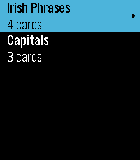
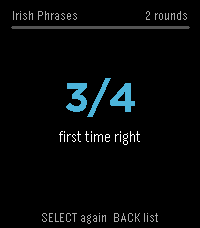

# Cue Card

A flashcards app for the **Pebble Time 2 (emery)**, in the same console idiom as
its sibling watchfaces [Homezone](../console-watchface) and
[Pit Wall](../f1-watchface).

Decks are written as plain text on your phone. The watch shows one card at a
time: press to flip, then say whether you had it. Anything you miss comes back
around before the session ends.

<p align="center">
  
  &nbsp;
  
  &nbsp;
  
  &nbsp;
  
</p>

## Writing decks

One `#` heading per deck, one card per line, with a `|` between the two sides:

```
# Irish Phrases
Dia duit | Hello
Go raibh maith agat | Thank you

# Capitals
Ireland | Dublin
Portugal | Lisbon
```

Blank lines are ignored. Only the first `|` splits a card, so an answer may
contain one of its own (`tá sé | it is | he is`). Cards written before any
heading go into a deck called *Untitled*, so a file with no headings at all
still works.

Two ways to get that text onto the phone, and the **Deck URL** wins if both are
set:

- **Deck URL** — a plain-text file anywhere reachable over HTTP. A raw Gist is
  the easy option. Editing the deck no longer means opening the settings.
- **Decks** — a textarea in the settings, for something quick.

A URL that cannot be reached falls back to the last copy that worked, so a
tunnel or a dead Wi-Fi network does not empty the watch.

## Using it

| | Face down | Flipped | Summary |
|---|---|---|---|
| **Select** | flip the card | — | go again |
| **Up** | — | got it | — |
| **Down** | — | missed it | — |
| **Back** | the deck list | the deck list | the deck list |

Up and Down do nothing until you have flipped. Grading is the one thing here
that cannot be taken back, and it should not be reachable by a thumb that has
got ahead of the screen.

The rule under the deck name is the accent colour while the question stands
alone, and plain once it has been answered — so a glance says which side is
showing without reading it.

### Rounds

A session deals the deck in a shuffled order. Cards you miss are collected as
you go, and when the deck runs out that collection becomes the next round. It
ends when everything has been got right at least once.

The score counts a card as right only if it was **never** missed, so `3/4` after
two rounds means three known on arrival — not three eventually dragged out.

## How it is split

The watch gets 4 kB of persistent storage. That is not enough for a library of
decks, so the library lives on the phone and the watch holds two smaller things:

- **The deck index** — every title and card count, about 30 bytes each. Kept for
  good, which is why the deck list opens and scrolls with the phone nowhere near.
- **One deck's cards** — whichever you last opened, up to 3 kB. Replaced when you
  open a different one.

The trade is that **switching decks needs the phone**; studying the one you have
does not. A deck already on the watch is marked with a dot in the list, and opens
without a round trip.

Both travel over the same chunked transfer, one chunk per message, each sent only
after the last was acknowledged — a persist field holds 256 bytes and neither
blob does. Sending them serially is what lets the watch insist on the chunk index
it is expecting and treat anything else as a transfer worth abandoning.

### Budgets

| | Limit | Where |
|---|---|---|
| Decks | 12 | `MAX_DECKS` |
| Cards per deck | 100 | `MAX_CARDS_PER_DECK` |
| Characters per side | 100 | `MAX_SIDE_CHARS` |
| Deck name | 24 characters | `MAX_TITLE_CHARS` |
| One deck's cards | 3072 bytes | `DECK_BUDGET_BYTES` |
| The deck index | 512 bytes | `MAX_INDEX_BYTES` |

Every one of these is enforced on the **phone**, in `src/pkjs/deck.js`. The watch
cannot tell anyone why a deck came up short, so an oversized deck is refused
before it is sent, with the line number that caused it. A deck that is merely
long is trimmed, and the trimming is reported the same way.

The last two are byte budgets rather than character ones, and the difference
matters: 24 characters of Irish or Japanese is not 24 bytes. Twelve worst-case
titles would be a kilobyte on their own.

### Staleness

The index carries a fingerprint of the whole library. Edit a deck on the phone —
rename it, reorder it, change a card — and the fingerprint changes, and the watch
throws away its cached deck rather than go on showing cards that may now sit at a
different place in the list.

## Layout

```
src/c/
  flashcards.c    app lifecycle and AppMessage — the only file that knows
                  a deck arrives over Bluetooth
  library.c       the index, the cached deck, the wire format, persistence
  session.c       one run through a deck: shuffling, rounds, the score
  deck_window.c   the deck list
  card_window.c   the card, the flip, the summary
  theme.c         the dark/light flip and the accent

src/pkjs/
  deck.js         parsing, limits, chunking, the fingerprint  (unit tested)
  index.js        settings, fetching, the chunked transfer
  config.js       the Clay settings page
```

Card text is arbitrary, so this app uses the system Gothic faces rather than the
subsetted Space Grotesk of its siblings — a subset is built from a known set of
characters, and there is no knowing these. `card_window.c` measures the text and
picks the largest size that fits, which is how three words fill the screen and
thirty still land inside it.

## Building

```bash
npm install
npm test                 # the phone-side parser: 38 tests

./build.sh               # build for the emulator
./build.sh --install     # build and install on a running emery emulator
./build.sh --prod        # release build -> ../cue-card-release.pbw
```

To open the settings page against the emulator, serve the project root so the
Clay proxy is reachable, then ask for the config:

```bash
python3 -m http.server 8888 --directory .
pebble emu-app-config --emulator emery
```

`clay-proxy.html` exists because Clay 1.0.4 always generates a
`clay.pebble.com` URL, and Chrome blocks the save redirect from a public page
back to localhost. Serving the page locally makes both ends local. A real phone
never touches it — see `IS_EMULATOR` in `src/pkjs/index.js`, which `./build.sh
--prod` sets to `false` for you.

## Known edges

- **One emulator at a time.** Two running instances will take an install and a
  screenshot on different watches, which looks exactly like an app that ignores
  its buttons.
- Decks cannot be edited on the watch. They are text on your phone, and that is
  the whole of the authoring story.
