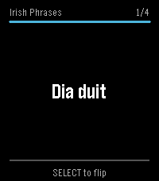
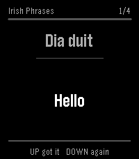

# Cue Card

A flashcards app for the **Pebble Time 2 (emery)**, in the same console idiom as
its sibling watchfaces [Homezone](../console-watchface) and
[Pit Wall](../f1-watchface).

Decks are written as plain text on your phone. The watch shows one card at a
time: press to flip, then say whether you had it. Anything you miss comes back
around before the session ends.

<p align="center">
  
  &nbsp;
  
  &nbsp;
  
  &nbsp;
  
</p>

## Writing decks

Three ways in, and the **Deck URL** wins over the other two if it is set.

### In the settings

Pick a deck, type a front and a back, press **Add**. The card joins the list
below and the boxes clear for the next one. Enter moves from front to back and
then adds, so a run of cards never needs the screen.

**New**, **Rename** and **Delete** manage the decks themselves.

### Import a file

**Choose file** takes a two-column CSV or TSV — front, then back — and appends
it to the deck you are on. That covers an Anki or Quizlet export, or anything
out of a spreadsheet. Quoted fields are handled, so an answer containing a comma
survives, and a `Front,Back` header row is dropped rather than imported as a
card.

### Point at a URL

**Deck URL** takes a plain-text file anywhere reachable over HTTP — a raw Gist,
or a published Google Sheet's CSV export. Editing the deck then never means
opening the settings at all. A URL that cannot be reached falls back to the last
copy that worked, so a tunnel or a dead Wi-Fi network does not empty the watch.

### The format underneath

The settings editor writes this, and a Deck URL can serve it directly:

```
# Irish Phrases
Dia duit | Hello
Go raibh maith agat | Thank you

# Capitals
Ireland | Dublin
```

A `#` heading opens a deck; everything under it is a card. Blank lines are
ignored, and cards before any heading go into a deck called *Untitled*, so a
file with no headings still works.

The separator is worked out from the file rather than insisted upon. A `|`
anywhere wins outright — so nothing written by hand changes meaning — and only
in its absence are tabs, semicolons and commas considered, whichever splits the
most lines in two. That is what lets a Deck URL point straight at a CSV. Only
the first separator splits a card, so an answer may contain one of its own
(`tá sé | it is | he is`).

## Using it

| | Face down | Flipped | Summary |
|---|---|---|---|
| **Select** | flip the card | — | go again |
| **Up** | — | got it | — |
| **Down** | — | missed it | — |
| **Back** | the deck list | the deck list | the deck list |

Up and Down do nothing until you have flipped. Grading is the one thing here
that cannot be taken back, and it should not be reachable by a thumb that has
got ahead of the screen.

The rule under the deck name is the accent colour while the question stands
alone, and plain once it has been answered — so a glance says which side is
showing without reading it.

### Rounds

A session deals the deck in a shuffled order. Cards you miss are collected as
you go, and when the deck runs out that collection becomes the next round. It
ends when everything has been got right at least once.

The score counts a card as right only if it was **never** missed, so `3/4` after
two rounds means three known on arrival — not three eventually dragged out.

## How it is split

The watch gets 4 kB of persistent storage. That is not enough for a library of
decks, so the library lives on the phone and the watch holds two smaller things:

- **The deck index** — every title and card count, about 30 bytes each. Kept for
  good, which is why the deck list opens and scrolls with the phone nowhere near.
- **One deck's cards** — whichever you last opened, up to 3 kB. Replaced when you
  open a different one.

The trade is that **switching decks needs the phone**; studying the one you have
does not. A deck already on the watch is marked with a dot in the list, and opens
without a round trip.

Both travel over the same chunked transfer, one chunk per message, each sent only
after the last was acknowledged — a persist field holds 256 bytes and neither
blob does. Sending them serially is what lets the watch insist on the chunk index
it is expecting and treat anything else as a transfer worth abandoning.

### Budgets

| | Limit | Where |
|---|---|---|
| Decks | 12 | `MAX_DECKS` |
| Cards per deck | 100 | `MAX_CARDS_PER_DECK` |
| Characters per side | 100 | `MAX_SIDE_CHARS` |
| Deck name | 24 characters | `MAX_TITLE_CHARS` |
| One deck's cards | 3072 bytes | `DECK_BUDGET_BYTES` |
| The deck index | 512 bytes | `MAX_INDEX_BYTES` |

Every one of these is enforced on the **phone**, in `src/pkjs/deck.js`. The watch
cannot tell anyone why a deck came up short, so an oversized deck is refused
before it is sent, with the line number that caused it. A deck that is merely
long is trimmed, and the trimming is reported the same way.

The last two are byte budgets rather than character ones, and the difference
matters: 24 characters of Irish or Japanese is not 24 bytes. Twelve worst-case
titles would be a kilobyte on their own.

### Staleness

The index carries a fingerprint of the whole library. Edit a deck on the phone —
rename it, reorder it, change a card — and the fingerprint changes, and the watch
throws away its cached deck rather than go on showing cards that may now sit at a
different place in the list.

## Layout

```
src/c/
  flashcards.c    app lifecycle and AppMessage — the only file that knows
                  a deck arrives over Bluetooth
  library.c       the index, the cached deck, the wire format, persistence
  session.c       one run through a deck: shuffling, rounds, the score
  deck_window.c   the deck list
  card_window.c   the card, the flip, the summary
  theme.c         the dark/light flip and the accent

src/pkjs/
  deck.js         parsing, limits, chunking, the fingerprint  (unit tested)
  index.js        settings, fetching, the chunked transfer
  config.js       the Clay settings page
  deck-editor.js  the front/back/Add editor and CSV import, as a Clay component
```

Card text is arbitrary, so this app uses the system Gothic faces rather than the
subsetted Space Grotesk of its siblings — a subset is built from a known set of
characters, and there is no knowing these. `card_window.c` measures the text and
picks the largest size that fits, which is how three words fill the screen and
thirty still land inside it.

## Building

```bash
npm install
npm test                 # the phone-side parser: 38 tests

./build.sh               # build for the emulator
./build.sh --install     # build and install on a running emery emulator
./build.sh --prod        # release build -> ../cue-card-release.pbw
```

To open the settings page against the emulator, serve the project root so the
Clay proxy is reachable, then ask for the config:

```bash
python3 -m http.server 8888 --directory .
pebble emu-app-config --emulator emery
```

`clay-proxy.html` exists because Clay 1.0.4 always generates a
`clay.pebble.com` URL, and Chrome blocks the save redirect from a public page
back to localhost. Serving the page locally makes both ends local. A real phone
never touches it — see `IS_EMULATOR` in `src/pkjs/index.js`, which `./build.sh
--prod` sets to `false` for you.

## Driving the emulator

```bash
pebble install --emulator emery --logs     # install, then stream logs
pebble emu-button --emulator emery click select
pebble screenshot --emulator emery --no-open shot.png
pebble kill                                # stop every running emulator
pebble wipe                                # clear emulator storage too
```

Buttons are `back`, `up`, `select`, `down` — **lowercase**, and the action comes
first: `click` (press and release), `push` (hold), `release`. Several at once,
or repeated, in one call:

```bash
pebble emu-button --emulator emery click select up
pebble emu-button --emulator emery click down -n 3 -i 300
pebble emu-button --emulator emery push select        # hold
pebble emu-button --emulator emery release select
```

### Settings without the config page

`send-app-message` injects an AppMessage straight into the running app, which is
far quicker than opening Clay to try a colour. It wants **numeric** keys, which
the build writes to `build/appinfo.json`:

```bash
python3 -c "import json;print(json.load(open('build/appinfo.json'))['appKeys'])"

# light theme, red accent  (10000 = SETTINGS_THEME, 10001 = SETTINGS_ACCENT)
pebble send-app-message --emulator emery --int 10000=1 10001=16733525
```

Note the single `--int` taking both pairs. Passing `--int` twice does **not**
send two keys — argparse keeps only the last one, so the first is silently
dropped and you get a message that looks half-applied.

For the real settings page, see [Building](#building) above.

### Gotchas

- **One emulator at a time.** Two instances take installs and screenshots on
  different watches, which looks exactly like an app ignoring its buttons.
  `pebble kill` first if in doubt.
- **Space out button presses.** Several `emu-button` calls fired back to back
  get dropped; use `-n`/`-i`, or put a second between them.
- **The emulator keeps its state** across runs, app included — handy for testing
  persistence, confusing when you expect a fresh boot. `pebble wipe` clears it.
- **Stream logs via `install --logs`.** `pebble logs` backgrounded on its own
  captured nothing here.

## Known edges

- Decks cannot be edited on the watch. They are written on the phone.
- Clay has no multi-line or repeating field of its own, so the editor is a
  custom component. Two things about that are worth knowing before touching
  `deck-editor.js`: its `initialize` is serialised with `toString()` and
  injected into the page, so it cannot `require()` anything or close over
  anything — every helper has to be nested inside it. And Clay runs it *before*
  setting the item's value, so the saved decks arrive later as a `change` event
  rather than being readable up front.
- Clay's own stylesheet gives every `button` a `min-width` of `12rem` and paints
  `strong` orange. A component that does not explicitly override those two
  inherits them, which looks like a layout bug in the component rather than
  something arriving from outside it.
