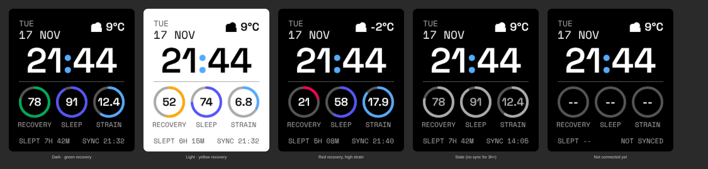

# Triad

A Whoop watchface for the **Pebble Time 2 (emery)**, in the same clean style as
[Homezone](../console-watchface). The time sits up top; below it are three ring
gauges for Whoop's core metrics: **recovery**, **sleep** and **strain**.

<p align="center">
  
</p>

> The preview is a browser render of the layout using the real fonts, not an
> emulator screenshot. Check the final positions in the emulator: Pebble's text
> offsets differ slightly from a browser's.

## Status

**Phase 1 of 4: design, with sample data.** The face draws a fixed sample
snapshot (`USE_MOCK_WHOOP` in `src/pkjs/index.js`) so the layout can be signed
off before any API work.

| Phase | Scope | Status |
|-------|-------|--------|
| 1 | Layout, weather, settings, sample Whoop data | ✅ |
| 2 | Whoop credentials on the config page, OAuth connect, token refresh | — |
| 3 | Live recovery / sleep / strain from the Whoop API | — |
| 4 | Polish, release build | — |

## Layout

```
  TUE                  ☁ 9°C     ← weekday · weather glyph + temperature
  17 NOV                         ← date

          21:44                  ← time (accent-coloured colon)
  ────────────────────────────
   (78)      (91)      (12.4)    ← ring gauges
  RECOVERY   SLEEP     STRAIN
  SLEPT 7H 42M      SYNC 21:32   ← hours asleep · last Whoop sync
```

| Ring | Value | Fill | Colour |
|------|-------|------|--------|
| Recovery | Recovery score, % | 0–100 | Whoop zone: green ≥ 67, yellow 34–66, red ≤ 33 |
| Sleep | Sleep performance, % | 0–100 | Blue-violet |
| Strain | Day strain, one decimal | 0–21 | Accent colour |

- **Stale data:** if the last sync is more than 3 hours old, the rings and
  values turn grey, so you can tell when the phone has stopped updating.
- **No data:** values read `--` until the first sync, or while Whoop hasn't
  scored a metric yet (e.g. recovery before you wake up).
- **Restarts:** the watch saves the last readings and weather, so the face is
  complete straight away rather than waiting for the phone.

## Settings

Through a [Clay](https://github.com/pebble/clay) config page:

- Light / dark theme (dark by default)
- Accent colour, which colours the clock colon and the strain ring (Picton
  blue by default)
- Temperature unit, °C / °F

The emulator config workaround is the same as Homezone's: see
[its README](../console-watchface/README.md#configuration).

## How Whoop access will work (phases 2–3)

Each user brings their own Whoop developer app, so no secret ships in the `.pbw`:

1. Create an app at the Whoop developer dashboard with scopes `read:recovery`,
   `read:sleep`, `read:cycles` and `offline`.
2. Paste its client ID and secret into the watchface's config page. They are
   stored only on your phone.
3. Connect: Whoop's login redirects to a small static page (hosted on Azure
   Static Web Apps, no secrets) that hands the code back to the watchface.
4. The phone exchanges and refreshes tokens itself, and polls Whoop every
   15 minutes.

## Building & running

```sh
./build.sh              # build for the emulator
./build.sh --install    # build and install on the running emery emulator
./build.sh --prod       # release build → ../whoop-watchface-release.pbw
```

> After changing `messageKeys` in `package.json`, run `pebble clean` before
> building, or the generated `MESSAGE_KEY_*` header goes stale.

## Testing

```sh
npm test
```

The tests cover the Whoop payload (integer encoding, clamping, unscored values),
recovery zones and weather mapping. They also read the C source and
`package.json` back and check that message keys, the icon enum, the recovery
thresholds, the default accent and the font character subsets all still agree.

## Architecture

| File | Role |
|------|------|
| `src/c/whoop-watchface.c` | Rendering, ring gauges, persisted readings and settings |
| `src/pkjs/index.js`       | Phone side: settings, weather, Whoop refresh, AppMessage queue |
| `src/pkjs/whoop.js`       | Whoop snapshot → watch payload, recovery zones, sample data |
| `src/pkjs/weather.js`     | Open-Meteo URL, response parsing, WMO → glyph mapping |
| `src/pkjs/accent.js`      | Accent colour default and validation |
| `src/pkjs/config.js`      | Clay config page |

### Message protocol

All values are integers. `-1` means "no reading".

| Key | Value |
|-----|-------|
| `WHOOP_RECOVERY` | 0–100 |
| `WHOOP_SLEEP_PERF` | 0–100 |
| `WHOOP_SLEEP_MINS` | minutes asleep |
| `WHOOP_STRAIN` | strain × 10 (0–210) |
| `WHOOP_SYNC_TIME` | Unix seconds of the sync; 0 = never |
| `WEATHER_TEMP` / `WEATHER_ICON` | °, glyph index |
| `SETTINGS_THEME` / `SETTINGS_TEMP_UNIT` / `SETTINGS_ACCENT` | 0/1, 0/1, 0xRRGGBB |
